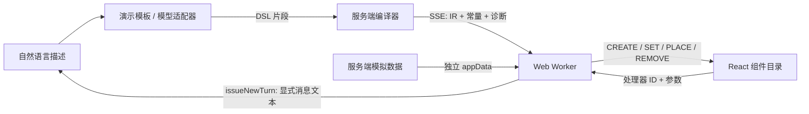

# 架构与协议

## 数据流



服务端编译**累计源码**。每次比较序列化的 IR 和常量表：程序变化才发送 `program`；只改变文字时发送 `constants`；正在接收不完整标签时只追加源码和诊断。浏览器合并 `delta`，把最新完整编译快照交给 Worker。没有使用虚构的 token 数或延迟数据。

## DSL 子集

```text
## GPU 温度监控
{@state rack = "Rack A01"}
{@state threshold = 80}
{@state selected = "GPU-A01-01:2"}
{@derive nodes = filterDevices(data.devices, rack, "GPU 服务器", false)}
{@derive cards = filterGpus(nodes, threshold, false)}
{@derive gpu = selectItem(cards, selected)}

<box variant="surface" padding={6} gap={5}>
  <slider label="温度阈值" min={60} max={95} value={threshold} onChange={setThreshold} />
  <gpus cards={cards} value={gpu.id} threshold={threshold} onChange={setSelected} />
  <button onClick={issueNewTurn("分析 GPU " + gpu.id + "，阈值 " + threshold)}>继续分析</button>
</box>
```

- 状态：`{@state name = literal}`；初始值支持字符串、非负数字、布尔值或 null；自动提供 `setName`。
- 派生值：`{@derive name = expression}`，按声明顺序求值。
- 表达式：基本四则/比较/逻辑/三元运算、数组、变量和数据属性访问。
- 纯函数：`round`、`min`、`max`、`money`、`percent`，以及监控专用的筛选、选择、告警与聚合函数（见 `src/core/monitoring.ts`）。
- 控件：`slider`、`toggle`、`select`、`rack`、`gpus`、`ports` 的 `onChange` 只允许已声明的 setter。
- 行为：`button.onClick` 只允许 `issueNewTurn(expression)` 或 `copy(expression)`。
- 布局：`padding` / `gap` 是 4px token，限制为 0–8；网格最多三列，窄屏自动折行。
- 表格：`columns` 是标题数组，`rows` 为二维数组；图表使用 `values`、`labels` 和可选 `multiplier`。

编译器不能识别的组件会连同子内容丢弃。无效属性会产生 `unknown_prop` / `invalid_literal` 等诊断；表达式中的属性也在运行时校验。半成品的表达式和标签会记录临时恢复诊断。它们不阻塞相邻有效组件。

## HTTP

| 接口                | 用途                                     |
| ------------------- | ---------------------------------------- |
| `GET /api/config`   | 模型是否已配置、模型名、目录版本；无密钥 |
| `POST /api/chat`    | 描述、模式、可选场景和历史，返回 SSE     |
| `POST /api/compile` | `{ source }`，返回编译快照与模拟数据     |

```sh
curl -N http://127.0.0.1:3000/api/chat \
  -H 'Content-Type: application/json' \
  -d '{"mode":"demo","prompt":"查看 Rack A01 的机架总览"}'
```

SSE 的每个 `data:` 是一个 JSON 事件：

```json
{"type":"meta","mode":"demo","scenario":"rack","model":"Deterministic demo","modelCalls":0}
{"type":"data","appData":{"site":{"source":"模拟遥测快照"},"devices":[]}}
{"type":"patch","append":"## 机架运行总览","delta":{"program":{},"constants":{},"diagnostics":[],"fallbackMarkdown":"## 机架运行总览"},"update":"program","sequence":1}
{"type":"done","duration":1234.5}
```

上例 `program: {}` 仅为缩写；实际结构为 `{ version: 1, states, derives, roots }`。事件中无模型调用并不等于没有网络请求：演示生成依然经过本机服务端和 SSE。只有界面内部的状态事件完全无需新请求。

输入最多 4,000 字符，DSL 最多 64,000 字符。限制组件数、嵌套层数和表达式复杂度；生成最长 90 秒。浏览器停止或断开连接后取消上游请求。上游断流、长度截断、拒答、HTTP 错误不会被标记为成功，也不会回显可能包含凭据的上游错误正文。

## Worker 与状态

每条回复持有一个 Worker。编译节点以源码偏移量为 ID，追加输出时保持稳定。状态以变量名为键；每次加载先加入新的初始值，再合并已有状态。后续对话新建回复，不修改旧回复。

Worker 将模板计算为纯 JSON 组件树，函数保留在内部，只向主线程发送处理器 ID。主线程只执行以下操作：

| 操作     | 含义                       |
| -------- | -------------------------- |
| `CREATE` | 添加已知类型的组件节点     |
| `SET`    | 替换实际发生变化的节点属性 |
| `PLACE`  | 更新子节点顺序             |
| `ROOT`   | 更新根节点顺序             |
| `REMOVE` | 删除节点                   |

不存在变化就发送空操作数组。局部表达式错误会产生运行时诊断，并保留其他有效组件；整体加载异常保留上一棵成功的树。主线程为消息设置 2 秒 watchdog，超时终止 Worker 并提供重启按钮。重启会重新初始化该回复的状态。

## 领域组件与对话上下文

`rack`、`gpus`、`ports` 只发送选择 ID，Runtime 再检查该 ID 是否属于当前可见数组。筛选导致原选择不可见时，`selectItem` 返回当前第一项或空记录，相关趋势和详情随之更新。空状态中的继续分析按钮禁用，Worker 也拒绝该 action。

`filterDevices`、`fleetStats`、`filterGpus`、`gpuStats`、`portStats` 等纯函数运行在 Worker。React 负责布局、状态色、原生控件和 SVG 曲线。没有每次点击重新问模型的流程。

Runtime 从已经求值的 scope 生成 `context`，包括 rack、category、range、threshold、onlyAlerts、onlyHot，以及有效的 deviceId、gpuId、portId。主线程将当前交互回复的 context 附在下一次 `POST /api/chat`；输入框和新消息显示相同摘要。

服务端 `parseViewContext` 拒绝未知字段、嵌套对象、无效枚举和非法 ID；`withViewContext` 把数据作为用户消息的附加说明提供给模型，不提升为系统指令。演示模板也使用该数据作为默认值，本轮显式条件优先。上下文仍属于不可信客户端数据，未来接入真实租户/资产后还需在后端做资产权限检查。

这部分参考 Open Intelligent UI 的回复状态与下一轮上下文机制，具体取舍见 [参考实现对照](reference-alignment.md)。

## 扩展

新增组件需同时更新 `src/core/catalog.ts` 的规则与 `src/components/Renderer.tsx` 的渲染分支。模型提示词会从目录读取属性规则。需要新行为时，在编译器和 Runtime 中显式实现受控 action，不增加任意代码执行入口。

接入外部业务数据可替换 `server/telemetry.ts` 的数据提供层，保持 appData 与模型源码分离。目录校验和 AST 解释器是不同防线：不得因为存在 Worker 就把任意模型代码交给 `eval`。

持久化、鉴权、调用限额、故障隔离、跨域沙箱、数据来源校验和完整可访问性审计都属于进一步产品化工作。当前工程目标是本机验证核心机制。
